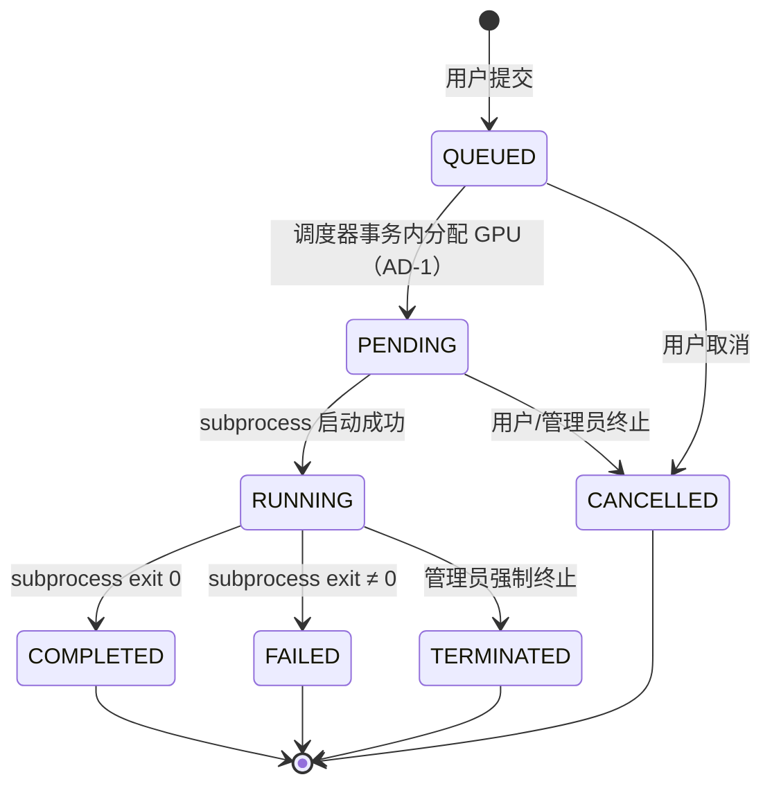
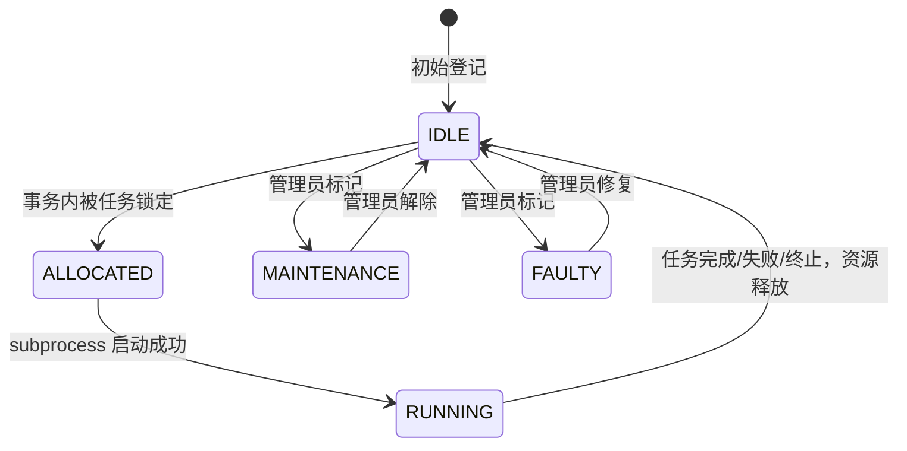

# State Machines

## Task 生命周期

## Task 状态说明

| 状态 | 含义 | 可转移到 |
|------|------|---------|
| QUEUED | 已提交，未分配 GPU | PENDING, CANCELLED |
| PENDING | GPU 已锁定，subprocess 启动中 | RUNNING, CANCELLED, TERMINATED |
| RUNNING | 进程正在运行 | COMPLETED, FAILED, TERMINATED |
| COMPLETED | 正常退出（exit code 0）— 终态 | — |
| FAILED | 异常退出（exit code ≠ 0）— 终态 | — |
| CANCELLED | 用户主动取消 — 终态 | — |
| TERMINATED | 管理员强制终止 — 终态 | — |

## GPU 状态机

## GPU 状态说明

| 状态 | 含义 | 参与分配 |
|------|------|---------|
| IDLE | 空闲可用 | ✅ |
| ALLOCATED | 已锁定给任务，subprocess 启动中 | ❌ |
| RUNNING | 任务正在执行 | ❌ |
| MAINTENANCE | 管理员标记维护中 | ❌ |
| FAULTY | 管理员标记故障 | ❌ |

## 并发冲突防护汇总

| 场景 | 防护手段 |
|------|---------|
| 多人同时抢最后一张卡 | MySQL `SELECT ... FOR UPDATE` 行锁 + 事务；第一个进入事务的获得锁，其余等待 → Lock wait timeout（1205）→ 后端捕获返回 409 |
| RUNNING 卡被标记维护 | 后端显式校验 `gpu.status != 'RUNNING'`，否则返回 400 |
| 取消与调度器竞争 | 调度器分配前已 FOR UPDATE 锁定 GPU；取消操作同样需要行锁 → 二者串行化 |
| 调度器多实例并发 | asyncio 单例（AD-3）进程级保证 |