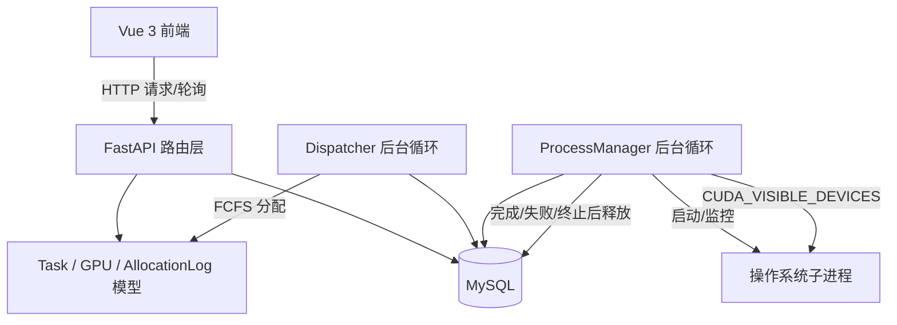

# GPU Queue Allocation 系统架构评审

- 评审对象：`compute-queue-allocation`
- 评审依据：本次提交的项目 ZIP 中的后端源码、前端源码、README、`docs/测试与部署手册.md` 及现有测试
- 评审角色：B（测试与架构验证负责人）
- 评审日期：2026-10-31
- 评审性质：静态代码与项目文档评审；尚未在本评审环境中重新启动 MySQL、后端和前端进行端到端验证

## 1. 评审结论摘要

系统采用前后端分离架构。前端为 Vue 3 + Element Plus，后端为 FastAPI，使用 SQLAlchemy Async 与 aiomysql 访问 MySQL。后端启动时同时启动 Dispatcher 和 ProcessManager 两个后台循环：Dispatcher 周期性从 FCFS 队列头部选择任务并分配 GPU；ProcessManager 启动待执行任务、监控子进程并在任务结束后回收 GPU。

从源码看，项目已经覆盖单卡/多卡分配、任务取消/终止、执行结果回写和分配日志等主要流程；现有自动化测试也包含 SQLite 业务测试、MySQL 并发测试及多 GPU 测试。

**总体判断：架构主链路清晰，适合作为课程项目/MVP；但当前仍存在需要在验收前重点验证的可靠性风险。** 其中最重要的是：并发正确性依赖 MySQL 行锁，不能用 SQLite 测试替代；并发测试会 `drop_all()` 数据库且连接参数写死；进程管理器停止时会杀进程并清空内存映射，但源码没有同步将数据库中的 RUNNING 任务和 GPU 状态恢复；认证目前是固定 `user_id=1` 的占位实现。

## 2. 系统架构与模块职责

### 2.1 技术组成

| 层次 | 技术/模块 | 主要职责 |
|---|---|---|
| 前端 | Vue 3、Element Plus、Vite | GPU 展示、任务提交、任务状态/队列展示和操作 |
| API 层 | FastAPI | `/health`、`/gpus`、`/tasks` 等 HTTP 接口 |
| 业务模型 | SQLAlchemy ORM Async | User、GPU、Task、AllocationLog 数据模型 |
| 数据访问 | SQLAlchemy Async、aiomysql | 异步数据库会话和 MySQL 访问 |
| 调度层 | `app/core/dispatcher.py` | FCFS 队首选择、单卡/同型号多卡分配、分配日志 |
| 执行层 | `app/core/process_manager.py` | 启动子进程、设置 `CUDA_VISIBLE_DEVICES`、收集退出码、释放资源 |
| 配置与日志 | `app/config.py`、`app/utils/logging_setup.py` | 环境配置和日志初始化 |

### 2.2 逻辑架构图



### 2.3 关键模块说明

**API 层**
- `app/main.py` 通过 FastAPI lifespan 初始化日志并启动 Dispatcher、ProcessManager；应用退出时先停止 ProcessManager，再停止 Dispatcher。
- GPU 路由提供登记、列表、状态/备注修改。
- Task 路由提供提交、列表、详情、取消和终止。
- 当前任务创建和个人任务列表接口默认使用 `user_id=1`，代码没有实现完整用户认证和授权。

**Dispatcher**
- 默认调度周期为 0.5 秒，单次 tick 最多尝试分配 5 次。
- 只选择状态为 `QUEUED` 的队首任务，排序键为 `submitted_at ASC, id ASC`。
- 单卡任务选择最早 ID 的空闲 GPU。
- 多卡任务要求一次性分配 N 张同型号空闲 GPU；有型号偏好时精确匹配该型号，否则以最早空闲 GPU 的型号为目标。
- 任务和 GPU 状态以及 `ALLOCATE` 日志在同一数据库事务中提交。
- 查询使用 `with_for_update()`，因此生产并发语义需要在支持行锁的 MySQL 环境验证。

**ProcessManager**
- 默认轮询周期为 0.5 秒。
- 从 `PENDING` 任务中查找待启动任务，按 `GPU.current_task_id` 找到任务占用的所有 GPU。
- 启动命令使用 `asyncio.create_subprocess_exec`，并把 GPU ID 逗号串写入 `CUDA_VISIBLE_DEVICES`。
- 任务退出码为 0 时标记 `COMPLETED`，非 0 时标记 `FAILED`；随后释放任务关联的所有 GPU，并写入 `RELEASE` 日志。
- Windows 下终止进程树使用 `taskkill /F /T /PID`。

### 2.4 核心数据对象

| 表/模型 | 关键字段 | 作用 |
|---|---|---|
| `tasks` / Task | `status`、`gpu_count`、`gpu_model_preference`、`allocated_gpu_id`、`allocated_gpu_ids`、时间戳、`exit_code` | 任务请求、生命周期和 GPU 分配结果 |
| `gpus` / GPU | `model`、`status`、`current_task_id`、`total_memory_mb` | GPU 资源状态及当前占用任务 |
| `allocation_log` / AllocationLog | `task_id`、`gpu_id`、`action`、`timestamp`、`notes` | 记录 GPU 分配和释放事件 |
| `users` / User | 用户 ID、用户名、角色 | 任务所属用户及角色占位数据 |

### 2.5 主要状态流转

```text
Task:
QUEUED -> PENDING -> RUNNING -> COMPLETED
                              -> FAILED
                    RUNNING -> TERMINATED
QUEUED -> CANCELLED

GPU:
IDLE -> ALLOCATED -> RUNNING -> IDLE
                         任务终止/启动失败/执行失败后释放回 IDLE
IDLE <-> MAINTENANCE（由管理接口设置，需遵守业务约束）
```

说明：`PENDING` 表示已分配 GPU、尚未由 ProcessManager 成功提升为 `RUNNING`。`CANCELLED` 是排队任务取消状态；`TERMINATED` 用于已进入分配/执行阶段的任务终止。

## 3. 关键业务流程

### 3.1 任务分配

1. 用户通过 `POST /tasks` 创建任务，任务初始状态为 `QUEUED`。
2. Dispatcher 按 `submitted_at`、`id` 选择队首任务。
3. 根据 `gpu_count` 选择一张或 N 张 GPU；多卡必须同型号且一次性凑齐。
4. GPU 状态更新为 `ALLOCATED`，`current_task_id` 指向任务。
5. Task 更新为 `PENDING`，写入 `allocated_gpu_id` 和 `allocated_gpu_ids`。
6. 同一事务写入对应数量的 `ALLOCATE` 日志并提交。

### 3.2 任务执行与回收

1. ProcessManager 查找 `PENDING` 任务。
2. 根据 `current_task_id` 找到该任务的全部 GPU。
3. 启动进程并设置 `CUDA_VISIBLE_DEVICES`。
4. 成功启动后，任务变为 `RUNNING`，GPU 变为 `RUNNING`。
5. 进程结束后根据退出码更新任务状态。
6. 清除所有关联 GPU 的 `current_task_id`，GPU 恢复 `IDLE`，逐卡写入 `RELEASE` 日志。

## 4. 架构优点

1. **职责分离明确**：HTTP API、调度和进程执行分别由路由层、Dispatcher、ProcessManager 负责。
2. **资源分配事务化**：任务状态、GPU 状态和分配日志在 Dispatcher 中同一事务提交，降低部分写入风险。
3. **FCFS 规则明确**：使用提交时间和任务 ID 排序，时间相同时仍有稳定的次序。
4. **多卡分配具有原子业务语义**：同型号 N 卡必须一次性凑齐，不会先占一部分再等待剩余 GPU。
5. **具备审计基础**：AllocationLog 记录逐卡分配和释放事件。
6. **Windows 进程树终止有专门处理**：使用 `taskkill /T` 处理 `cmd.exe` 派生子进程残留问题。

## 5. 架构问题与改进建议

| 编号 | 观察到的问题 | 影响 | 建议 |
|---|---|---|---|
| AR-01 | ProcessManager 的 `stop()` 杀掉活动进程并清空内存映射，但未在数据库中回写任务状态和 GPU 状态 | 服务重启后可能遗留 RUNNING 任务和 RUNNING GPU | 设计优雅关闭/崩溃恢复流程；启动时扫描孤儿任务并按进程存活信息恢复或标记失败 |
| AR-02 | 当前认证以固定 `user_id=1` 为占位，终止接口没有真正的角色授权链路 | 多用户隔离和管理操作安全性不足 | 上线前增加身份认证、用户级数据隔离和管理员权限检查 |
| AR-03 | 并发测试固定使用 MySQL URL，且 fixture 对 schema 执行 `drop_all/create_all` | 测试可能清空开发/共享数据库 | 使用专用测试库、独立账号和环境变量配置；测试前强制校验库名 |
| AR-04 | SQLite 不支持 MySQL `SELECT ... FOR UPDATE` 的等价行锁语义 | SQLite 业务测试不能证明真实并发安全 | 把 SQLite 测试定位为功能测试；并发锁测试必须在隔离 MySQL 实例执行 |
| AR-05 | GPU 管理 API 可直接修改状态，除 RUNNING 到 MAINTENANCE/FAULTY 的限制外，未全面校验状态与 `current_task_id` 的一致性 | 可能制造“状态空闲但仍绑定任务”等异常数据 | 建立 GPU 状态转换规则，禁止通过普通更新接口覆盖调度器管理的占用状态 |
| AR-06 | `CUDA_VISIBLE_DEVICES` 使用数据库 GPU 主键 ID | 若数据库 ID 不等于机器实际 CUDA 设备序号，会选错设备 | 增加独立 `device_index`/UUID 字段，使用真实设备标识映射 |
| AR-07 | Dispatcher 队首阻塞策略会让多卡任务在资源不足时阻挡后续可运行单卡任务 | 降低资源利用率 | 作为明确的 FCFS 取舍记录；若未来改为跳过策略，必须更新需求、调度规则和测试 |
| AR-08 | `priority` 字段存在但当前排序不使用 | 用户可能误以为优先级生效 | UI/接口明确标注暂不支持，或在后续需求中实现并更新排序测试 |
| AR-09 | AllocationLog 的 task_id/gpu_id 在模型中未声明外键约束 | 数据库层不能阻止孤立日志记录 | 评估增加外键或由事务层和一致性巡检保证 |
| AR-10 | 前端以 3 秒轮询更新状态，没有 WebSocket 推送 | 状态展示有延迟，任务数大时产生轮询开销 | MVP 可接受；规模扩大后考虑事件推送或自适应轮询 |

## 6. 评审结论与验收建议

**静态评审结论：有条件通过，需完成高风险项验证后再做最终验收。**

验收前至少完成：
- 在隔离 MySQL 测试库中执行并发分配测试，证明单卡不会重复分配。
- 执行多 GPU 同型号分配、资源不足队首阻塞和多卡释放测试。
- 执行任务成功、失败、取消、终止的生命周期测试。
- 检查任务、GPU、AllocationLog 三者一致性。
- 验证服务停止/重启后的任务与 GPU 状态恢复策略；若当前不支持，应在已知限制中明确。
- 确认测试不会连接开发/生产数据库。

## 7. 评审范围限制

本文件依据本次上传 ZIP 中的源码和文档形成。没有对真实 GPU 设备执行 CUDA 训练任务，也没有在本次评审过程中重新启动 MySQL 并发测试。因此，涉及实际 CUDA 设备编号、MySQL 行锁竞争和部署环境的结论仍需运行验证。